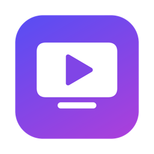
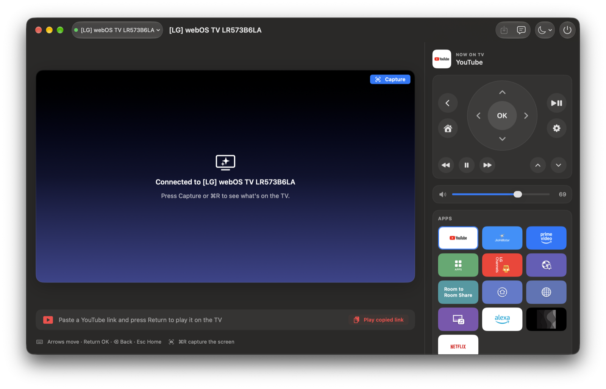

<p align="center">
  
</p>

<h1 align="center">TV Remote</h1>

<p align="center">
  A fast, native Mac app to control your <b>LG webOS TV</b> over Wi-Fi.<br>
  Remote, keyboard, apps, inputs, volume, screen capture and <b>send YouTube videos to the TV</b>.
</p>

<p align="center">
  <a href="https://github.com/pcgotan/webos-tv-remote/releases/latest"></a>
  
  
  
</p>



## Features

- **Finds your TV by itself.** Open the app, pick your TV, press **Allow** on the TV once. No LG account, no Developer Mode.
- **Remote:** D-pad, OK, Back, Home, play/pause, rewind, fast-forward, channel up/down, TV settings.
- **Your Mac keyboard is the remote** while the app is in front: arrows move, Return is OK, Backspace is Back, Esc is Home.
- **Type on the TV:** when a text box opens on the TV (search, browser, Wi-Fi password), type on your Mac and the text appears instantly. ⌘V pastes.
- **Send to YouTube:** paste a YouTube link and it plays in the TV's YouTube app, signed in to your account. **Queue** adds it to what's playing. Recent videos are listed with titles and thumbnails.
- **Apps and inputs:** every app on the TV with its real icon, plus HDMI inputs with connection status and Live TV.
- **Volume and mute** with a smooth slider.
- **Screen capture:** see what's on the TV with one click (⌘R), save it to the Desktop or copy it.
- **Message on the TV:** show a short notification on the TV screen.
- **Sleep timer:** turn the TV off in 15 to 120 minutes, with a warning on the TV one minute before.
- **Power:** turn the TV off; turn it on with Wake-on-LAN (see [Turning the TV on](#turning-the-tv-on)).
- **Several TVs:** switch, add or forget TVs from the menu at the top left.
- **Global shortcuts** that work from any app (below), plus a menu-bar icon.
- **Light:** under 3 MB (Apple silicon + Intel), native SwiftUI, no third-party code. It talks to the TV only when you do something.

## Install

1. Download **`TV-Remote-1.0.0.dmg`** from the [latest release](https://github.com/pcgotan/webos-tv-remote/releases/latest).
2. Open it and drag **TV Remote** to **Applications**.
3. The app is not notarized by Apple, so the first time:
   - **Right-click** TV Remote in Applications → **Open** → **Open**, or
   - System Settings → **Privacy & Security** → scroll down → **Open Anyway**.

## First run

1. Make sure the Mac and the TV are on the **same Wi-Fi network** and the TV is on.
2. Open TV Remote. When macOS asks to **find devices on your local network**, click **Allow**. Without it the app can't see the TV.
3. Your TV appears in the list. Click it.
4. On the TV, choose **Allow** with the TV remote. This happens only once per Mac.

If the TV doesn't appear, turn on the TV setting that lets phone apps connect. On most LG TVs it's in
**Settings → General → Devices → External Devices**, named **LG Connect Apps** or similar.

## Keyboard shortcuts

| Where | Shortcut | Action |
|---|---|---|
| App in front | ↑ ↓ ← → | Move |
| App in front | Return | OK |
| App in front | Backspace (⌫) | Back (deletes a character while the TV keyboard is open) |
| App in front | Esc | Home |
| App in front | ⌘R | Capture the TV screen |
| App in front | ⇧⌘S | Save the capture to the Desktop |
| App in front | ⌘↑ / ⌘↓ | Volume up / down |
| App in front | ⇧⌘M | Mute |
| Anywhere | ⌥⌘T | Show TV Remote |
| Anywhere | ⌥⌘Y | Play the YouTube link on the clipboard |
| Anywhere | ⌥⌘↑ / ⌥⌘↓ | Volume up / down |
| Anywhere | ⌥⌘P | Play / pause |

## Turning the TV on

LG TVs only accept "turn on" over Wake-on-LAN. Turn on **Settings → General → Devices → TV Management → Turn on via Wi-Fi**
(the name differs a little by model), and connect the app once while the TV is on so it learns the TV's network address.

## Limits

- The Mac and TV must be on the **same network**. LG does not offer a public internet API for TVs.
- **Typing goes into LG's own text boxes.** YouTube draws its own keyboard and ignores typed text: use **Send to YouTube** instead.
- **Screen capture** is a still image (960×540), not video. Some apps (for example Prime Video) may show black because of copy protection.
- The **sleep timer** runs inside the app, so keep the app open.

## How it works

- **TV control** uses LG's second-screen protocol (SSAP over a secure WebSocket on port 3001), the same one LG's phone app uses. The TV issues a key when you press Allow; the app stores it in its preferences.
- **Discovery** uses SSDP on the local network.
- **Send to YouTube** finds the TV's YouTube app with DIAL, then uses YouTube's Lounge API (the protocol phones use to cast) to play or queue the video. Titles and thumbnails come from YouTube's public oEmbed endpoint.
- **Privacy:** the app talks only to your TV and, for Send to YouTube, to youtube.com. No analytics, no accounts.

## Build from source

Requires Xcode 15 or later (Swift 5.9+), macOS 14+.

```bash
git clone https://github.com/pcgotan/webos-tv-remote.git
cd webos-tv-remote
scripts/build.sh             # builds build/TV Remote.app (universal)
scripts/build.sh --install   # also copies it to /Applications
scripts/make-dmg.sh          # builds build/TV-Remote-<version>.dmg
swift scripts/make-icon.swift .   # redraws Resources/AppIcon.icns
```

Self-test against a TV that is already paired:

```bash
"/Applications/TV Remote.app/Contents/MacOS/TVRemote" --selftest
```

Source layout:

| File | What it does |
|---|---|
| `Sources/TV.swift` | Connection, pairing, every TV command |
| `Sources/YouTube.swift` | DIAL + YouTube Lounge "send to TV" |
| `Sources/Core.swift` | Saved TVs, SSDP discovery, Wake-on-LAN, YouTube link parsing |
| `Sources/Views.swift` | The interface |
| `Sources/App.swift` | App, menus, keyboard handling, global shortcuts, self-test |

## Troubleshooting

- **"Waiting for Allow on the TV" never ends:** the prompt may have timed out on the TV. Choose **Forget This TV** in the TV menu and add it again.
- **TV shows as offline:** check the TV is on and on the same network. The app reconnects by itself when the TV comes back.
- **Send to YouTube says YouTube didn't answer:** open YouTube on the TV once, then try again.

## Disclaimer

Not affiliated with or endorsed by LG Electronics or Google. LG, webOS and YouTube are trademarks of their owners.

## License

[MIT](LICENSE) © 2026 Prashant Chouhan
